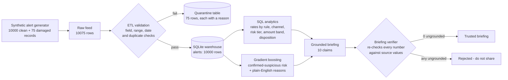

# AML Alert Analytics

A production-style finance analytics pipeline that follows a transaction-monitoring alert from a messy raw feed all the way to a decision an AML team could act on: which alerts are most likely to be genuinely suspicious, why, and what the numbers actually say, with every number in the final briefing re-checked against the warehouse before it is trusted.

Built by Jagadeeswara Rao Padala (MSc Artificial Intelligence, Aston University) as a pairing of data analytics and applied AI: a data pipeline and SQL analytics layer underneath, and an explainable machine learning model with a grounded plain-English briefing on top.

## The problem

Transaction-monitoring systems generate far more alerts than analyst teams can review in depth, and most alerts turn out to be false positives. The genuinely suspicious cases are not spread evenly: they concentrate in particular rules, channels, customer risk tiers and amount bands, and the signals are sitting in alert data that is often too messy to analyse directly. This project tackles the whole chain: clean the feed without hiding its faults, measure confirmed-suspicious patterns honestly, score individual alerts with reasons attached, and report the findings in language where no number is invented.

All data is synthetic. No real customer, account or transaction records are used anywhere in this project.

## Architecture



## What it does

1. **Synthetic data generation** (`src/generate.py`): 10,000 clean alert records with customer id, alert date, transaction amount, channel (online, mobile, branch, wire, atm, correspondent), alert rule (large transaction, structuring, high-risk country, rapid movement, dormant account, sanctions match), customer risk tier, prior alerts, account age and analyst disposition. The confirmed-suspicious outcome is generated with realistic risk logic: larger amounts, a high risk tier, structuring or sanctions rules, prior alerts, wire or correspondent channels and very new accounts all raise the risk, so there is a genuine signal to find. Exactly 75 deliberately corrupted records (bad amounts, missing customer ids, impossible dates, duplicate alert ids, invalid codes and out-of-range values) are injected, for a raw feed of 10,075 rows. Fixed seed, fully reproducible.
2. **ETL with quarantine** (`src/etl.py`): every record is validated for missing values, impossible or malformed dates, out-of-range amounts, prior alerts and account age, invalid channel, rule and risk tier codes, invalid confirmed-suspicious flags, inconsistent dispositions and duplicate alert IDs. Failures are never dropped silently: they land in a `quarantine` table with a reason. Clean records load into an `alerts` table in a SQLite warehouse.
3. **SQL analytics** (`src/analytics.py`): headline measures are computed with SQL queries against the warehouse, not ad-hoc dataframe arithmetic: overall confirmed-suspicious rate, rate by alert rule, by channel, by customer risk tier, by amount band, analyst disposition counts, and median transaction amount for confirmed-suspicious versus other alerts.
4. **Risk model** (`src/model.py`): a scikit-learn `GradientBoostingClassifier` on a stratified train/test split scores confirmed-suspicious risk. Evaluation reports test ROC-AUC and top-decile capture: the share of all confirmed-suspicious cases concentrated in the highest-risk 10% of alerts, which is the number a team with limited analyst capacity actually cares about. Each high-risk alert also gets plain-English reasons, such as "6 prior alerts for this customer".
5. **Grounded briefing** (`src/briefing.py`): 10 factual claims written only from the analytics and model results. A verifier then extracts every number from every claim and re-checks it against the source values. Any claim with an untraceable number is counted as ungrounded, and the demo refuses to present a briefing with ungrounded claims.

## Sample output

Real output from `python run_demo.py` (seed 42):

```
[1/5] Generated raw alert feed: 10075 rows
[2/5] ETL complete: 75 quarantined, 10000 loaded into SQLite warehouse
[3/5] SQL analytics: overall confirmed-suspicious rate 17.1% (1705 of 10000 alerts)
      Riskiest rule: large_transaction at 22.2%
[4/5] Model: test ROC-AUC 0.727 | top-decile capture 27.0% of confirmed-suspicious cases
[5/5] Grounded briefing: 10 claims, 0 ungrounded
```

Confirmed-suspicious rate by alert rule:

| Rule | Suspicious / alerts | Rate |
|---|---|---|
| large_transaction | 647 / 2916 | 22.2% |
| sanctions_match | 174 / 818 | 21.3% |
| structuring | 335 / 1825 | 18.4% |
| high_risk_country | 223 / 1592 | 14.0% |
| rapid_movement | 226 / 1648 | 13.7% |
| dormant_account | 100 / 1201 | 8.3% |

Headline findings from the same run:

- High risk tier customers were confirmed suspicious at 32.9% (485 of 1473 alerts), compared with 17.5% for medium tier customers (571 of 3263) and 12.3% for low tier customers (649 of 5264).
- The correspondent channel had the highest rate by channel, at 24.3% (196 of 808 alerts), followed by wire at 19.1% (259 of 1356).
- Alerts for amounts of 50,000 or more were confirmed suspicious at 33.9% (312 of 920 alerts), compared with 19.1% for the 10,000 to 50,000 band (467 of 2445), 14.1% for the 1,000 to 10,000 band (800 of 5671) and 13.1% for amounts under 1,000 (126 of 964).
- Analysts closed 8295 alerts as false positives and confirmed 1705 alerts as suspicious.
- Median transaction amount was 7872.70 for confirmed-suspicious alerts and 4786.53 for alerts that were not confirmed suspicious.
- The model's highest-risk test alert (AML-07662, large_transaction, risk 0.941) carried the reasons: large transaction amount of 226,663.67, customer in the high risk tier, 6 prior alerts for this customer, new account opened 5 days ago, correspondent channel.
- The model's most important feature was prior alerts (importance 0.3112), followed by transaction amount (0.3052) and account age (0.1280).

Briefing verification: **10 claims, 0 ungrounded.**

## How to run

```bash
pip install -r requirements.txt
python run_demo.py
python -m pytest tests/ -q
```

The demo regenerates the raw feed (`data/alerts_raw.csv`), rebuilds the warehouse (`data/warehouse.db`) and writes a machine-readable run summary (`data/summary.json`) on every run, so the numbers above reproduce exactly. A small clean sample is kept at `data/sample_alerts.csv`.

## Tests

8 pytest tests cover the whole contract: raw feed size, exact ETL quarantine count (75, each with a reason), warehouse row count (10,000), analytics sanity (rule and channel rates reconcile with the overall count, risk tier and amount band gradients present, disposition counts reconcile), model quality (ROC-AUC above 0.70, top-decile capture above 25%), briefing grounding (0 ungrounded), the verifier catching an invented number, and plain-English risk reasons.

## Tech stack

Python, pandas, scikit-learn, SQLite (standard library), pytest. No external APIs, no API keys, no secrets.

## Limitations

The data is synthetic and the risk logic is built in by design, so the model metrics show the pipeline works end to end. They are not evidence about any real monitoring system and this is not a compliance tool. On real data the same stages would need proper governance, calibration checks, fairness review and human analyst oversight before any operational use.
