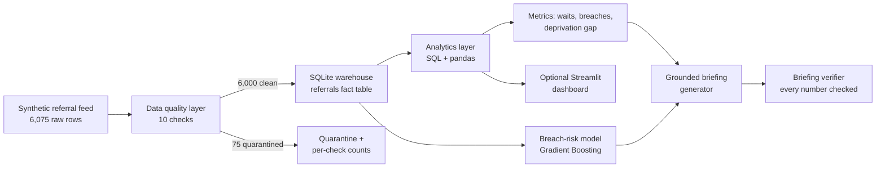

# care-wait-analytics

Elective waiting-list analytics for a health service, built end to end: a data pipeline, a warehouse, an analytics layer, an AI breach-risk model, and a management briefing that is checked for groundedness before it is allowed out.

All data is synthetic. No real patient records are used, and no external API or API key is needed.

## The problem

A waiting list is only manageable if the numbers behind it can be trusted. Referral feeds are messy, waits vary sharply by specialty, and headline averages hide who is waiting longest. Managers need three things: clean data they can reconcile, analytics that show where the pressure is, and an early warning for referrals that are likely to breach the 18-week standard while there is still time to act.

## What it does

1. **Pipeline**: generates 6,075 synthetic referral rows (6,000 clean referrals plus 75 deliberately dirty rows) and runs 10 data quality checks. Dirty rows go to a quarantine set with a per-check failure count, never a silent drop.
2. **Warehouse**: loads the 6,000 clean referrals into a SQLite warehouse with one fact table, loaded idempotently.
3. **Analytics**: SQL and pandas queries for overall waits, waits by specialty, monthly trend, routine vs urgent split, and a deprivation gap analysis.
4. **AI component 1, breach-risk model**: a Gradient Boosting classifier predicts, at the point of referral, whether a patient will wait longer than 18 weeks, using only features known on day one (specialty, priority, age band, deprivation quintile, referral month). Feature importance is grouped, so the output reads as "specialty" rather than a list of dummy columns.
5. **AI component 2, grounded briefing**: a narrative briefing is generated only from the computed metrics, then a verifier extracts every number from the finished text and checks it against the analytics layer. Any number that did not come from the pipeline is flagged. A fluent paragraph is not evidence.

## Architecture



## Results (from `scripts/run_demo.py`, seeded, reproducible)

| Measure | Value |
|---|---|
| Raw rows | 6,075 |
| Clean rows loaded to warehouse | 6,000 |
| Quarantined rows | 75 (30 duplicates, 20 missing specialty, 15 negative waits, 10 invalid age bands) |
| Median wait | 97 days |
| Mean wait | 101.0 days |
| Breaches over 18 weeks | 1,586 (26.4%) |
| Longest median wait | Orthopaedics, 125 days (49.2% breach rate) |
| Shortest median wait | Cardiology, 72 days (2.8% breach rate) |
| Routine vs urgent median wait | 108 days vs 59 days |
| Deprivation gap (most vs least deprived quintile) | 110 vs 82 median days, a 28-day gap; breach 36.7% vs 15.7% |
| Breach-risk model | ROC-AUC 0.8516, accuracy 0.7917 on a 1,200-referral held-out test set |
| Top model signals (grouped importance) | specialty 0.5383, priority 0.3270, imd_quintile 0.1057 |
| Briefing groundedness check | 0 ungrounded numbers |

## How to run

```bash
pip install -r requirements.txt
python scripts/run_demo.py
pytest tests/ -q
```

`run_demo.py` writes `outputs/report.json` (every number in this README) and `outputs/briefing.md` (the verified briefing). An optional dashboard reads only those outputs:

```bash
pip install streamlit
streamlit run app/dashboard.py
```

## Sample output (briefing, verified)

Across 6000 synthetic elective referrals, the median wait was 97 days and the mean wait was 101 days. 1586 referrals waited longer than 18 weeks, a breach rate of 26.4%.

The longest median wait was in Orthopaedics at 125 days. The shortest was in Cardiology at 72 days.

Patients in the most deprived quintile waited a median of 110 days, compared with 82 days in the least deprived quintile, a gap of 28 days. Their breach rates were 36.7% and 15.7%.

## Layout

- `care_wait/data_gen.py`: seeded synthetic generator, plus the deliberate dirty rows
- `care_wait/quality.py`: 10 data quality checks and quarantine
- `care_wait/warehouse.py`: SQLite warehouse load and read
- `care_wait/analytics.py`: analytics queries and metrics
- `care_wait/model.py`: breach-risk model with grouped feature importance
- `care_wait/briefing.py`: briefing generator and groundedness verifier
- `scripts/run_demo.py`: end-to-end run
- `app/dashboard.py`: optional Streamlit dashboard over the report outputs
- `data/`: data dictionary and a 500-row sample of the clean synthetic data
- `tests/test_smoke.py`: 5 tests (determinism, quarantine counts, analytics consistency, model quality, briefing groundedness including a tamper test)

## Honest limits

The referral patterns are synthetic and simplified: real waiting lists involve clock pauses, diagnostic stages and clinical prioritisation that are not modelled here. The model is a triage aid for analysis, not a clinical tool. The point of the project is the engineering pattern: reconcile the data first, compute the analytics in one place, let the AI work from those numbers, and verify anything written in prose against them.
