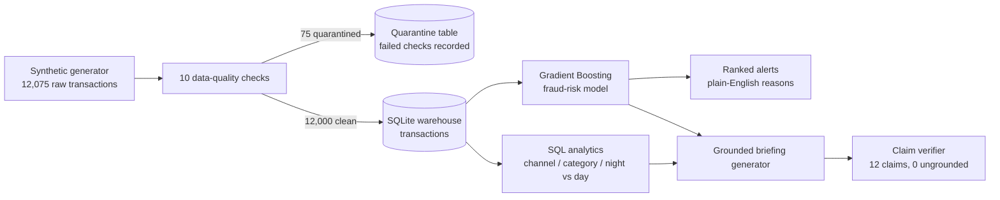

# fraud-signal-analytics

**Finance-sector flagship.** A production-style pairing of data analytics and AI for card fraud: a transaction pipeline with data-quality checks into a SQLite warehouse, SQL analytics over channels, categories and time of day, a Gradient Boosting fraud-risk model, and a grounded analyst briefing where every stated number is verified against its source before the briefing is allowed out.

## The problem

A fraud operations team does not drown in transactions, it drowns in review queues. Reviewing everything is impossible, reviewing at random wastes the analysts, and a model score on its own does not tell an analyst why a transaction was flagged. This build covers the whole chain: trustworthy data in, honest analytics in the middle, a risk model that ranks the queue, and explanations and a briefing that a human can act on and check.

The data is synthetic and deliberately fraud-enriched (5.92% fraud, far above a real card portfolio) so the model has enough positives to learn from. Every number below was produced by running the code, seed 42 throughout.

## Architecture



## What the run produces (verified, seed 42)

| Stage | Result |
|---|---|
| Raw transactions generated | 12,075 |
| Quarantined by 10 DQ checks | 75 (40 duplicate ids, 17 non-positive amounts, 10 missing customers, 8 invalid channels) |
| Clean transactions in warehouse | 12,000 |
| Total clean value | £1,121,834.45 |
| Fraud transactions | 711 (5.92%) |
| Fraud value | £102,154.48, which is 9.11% of all value |
| Riskiest channel | online, 11.20% fraud (in-store is lowest at 3.09%) |
| Riskiest merchant category | electronics, 11.68% (travel 11.50%, gambling 10.02%) |
| Night (00:00-05:59) vs day fraud rate | 10.74% vs 5.66% |
| Model ROC-AUC (held-out test, 2,400 rows) | 0.8203 |
| Model PR-AUC | 0.3563 |
| Fraud captured by reviewing riskiest 10% | 52.8% |
| Briefing claims verified | 12 checked, 0 ungrounded |
| Tests | 7 passed |

Top model signals by permutation importance: transaction velocity in 10 minutes, channel, amount, new device, foreign transaction. That ordering matches how the fraud was generated, which is a useful sanity check on the whole chain.

The highest-scored alert in the test split (transaction T104905, model probability 0.9660, genuinely fraud) is explained in plain English as: "7 transactions inside 10 minutes; online channel". No black-box shrug.

## Sample briefing output

```text
Fraud signal briefing

The warehouse holds 12,000 clean card transactions after 75 dirty rows were quarantined by 10 data-quality checks.
Fraud accounts for 711 transactions, a fraud rate of 5.92%, worth £102,154.48 in fraudulent value.
The riskiest channel is online at 11.20% fraud, and the riskiest merchant category is electronics.
Night-time transactions (00:00 to 05:59) run at 10.74% fraud against 5.66% in the day, so overnight monitoring is where review capacity earns most.
The Gradient Boosting risk model scores ROC-AUC 0.8203 on held-out data. Reviewing only the riskiest 10% of transactions would surface 52.8% of all fraud. The strongest single signal is velocity 10min.
```

Every number in that briefing is registered as a claim and re-checked against the warehouse and model results by `verify_briefing`. A mismatch fails the run instead of shipping.

## How to run

```bash
pip install -r requirements.txt
python run_demo.py            # writes outputs/summary.json and outputs/briefing.txt
pytest                        # 7 tests
streamlit run app/dashboard.py   # optional dashboard over the warehouse
```

No API keys, no external services. `data/sample_transactions.csv` holds the first 200 raw rows so the input shape is visible without running the generator.

## Layout

- `fraud_signal/generate.py` — deterministic synthetic transactions plus 75 injected dirty rows
- `fraud_signal/pipeline.py` — the 10 data-quality checks, quarantine, warehouse load
- `fraud_signal/analytics.py` — the SQL behind every headline number
- `fraud_signal/model.py` — feature engineering, Gradient Boosting, honest held-out evaluation
- `fraud_signal/briefing.py` — grounded briefing, claim verifier, alert explanations
- `app/dashboard.py` — optional Streamlit dashboard
- `tests/test_fraud_signal.py` — reconciliation, quarantine counts, model quality and grounding tests

## Honest limits

Synthetic data with a known fraud process, so the model is partly rediscovering the generator's rules; a real deployment would face concept drift, adversarial adaptation and far rarer fraud. Recall at a 0.5 threshold is low (0.2042), which is exactly why the briefing leads with top-decile capture instead: this model is a queue-ranking tool for analysts, not an auto-decline engine.

## Author

Jagadeeswara Rao Padala — MSc Artificial Intelligence (Aston University), Data Analyst and AI Engineer, Birmingham, UK. Part of the weekly flagship series in [AI-builds](https://github.com/Jagadeesh5045/AI-builds).
