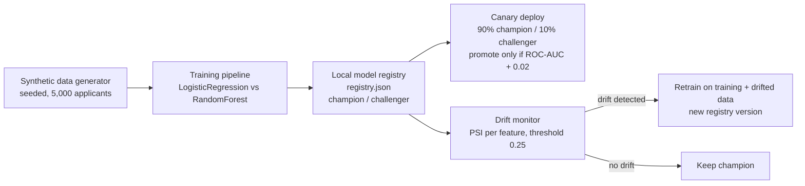

# MLOps Credit: default prediction with a model registry, canary deploys and drift-triggered retraining

A small, fully offline MLOps pipeline for credit default prediction. It
trains competing models on a synthetic applicant dataset, registers them
in a local JSON model registry, serves the champion behind a 90/10
canary split, and watches the incoming data for drift, retraining
automatically when drift crosses a threshold.

No real applicant data, no external APIs, no API keys. Everything runs
locally with scikit-learn.

## Problem statement

Lenders score applicants on income, loan size, credit history,
employment stability, debt burden and repayment behaviour, but a model
that is accurate on day one quietly degrades as the applicant population
changes (for example, during an economic downturn). This project
demonstrates the three operational habits that keep a scoring model
honest in production:

1. **Versioned registry** — every run is recorded with its model type,
   hyperparameters, test metrics and champion/challenger status, so any
   decision can be traced back to a version.
2. **Canary deployment** — a challenger model only ever sees 10% of
   traffic, and is promoted only if it beats the champion by a stated
   margin (0.02 ROC-AUC).
3. **Drift-triggered retraining** — Population Stability Index (PSI) is
   computed per feature against the training data; a PSI above 0.25 on
   any feature triggers a retrain and a new registry version.

## Architecture



## How to run

```bash
pip install -r requirements.txt
python scripts/run_demo.py
```

Individual stages:

```bash
python scripts/train.py    # train, evaluate, register champion + challenger
python scripts/canary.py   # 90/10 canary comparison and promotion decision
python scripts/drift.py    # PSI drift check and retraining trigger
python -m pytest tests/    # smoke tests
```

## Data

`data/credit.csv` — 5,000 synthetic applicants, generated with seed 42
(default rate 20.22%). See `data/DATA_DICTIONARY.md` for the column
definitions. Features: income, loan amount, credit history length,
employment years, debt-to-income ratio, number of late payments and age
band; the target is a binary default flag.

## Sample output (measured 2026-10-30, `python scripts/run_demo.py`)

Held-out test set: **1,000 applicants** (80/20 stratified split).

| Model | Accuracy | ROC-AUC | Precision | Recall | F1 |
| --- | --- | --- | --- | --- | --- |
| LogisticRegression (champion) | 0.803 | 0.6886 | 0.5641 | 0.1089 | 0.1826 |
| RandomForestClassifier (challenger) | 0.808 | 0.6580 | 0.6087 | 0.1386 | 0.2258 |

**Canary (2,000-applicant batch, 90% champion / 10% challenger):**
champion ROC-AUC 0.6794 vs challenger 0.6658. The challenger did not
beat the champion by the 0.02 promotion margin, so the decision was
**KEEP champion**.

**Drift (income shifted to 70%, late payments raised):**

| Feature | PSI |
| --- | --- |
| income | 0.3773 |
| loan_amount | 0.0110 |
| credit_history_years | 0.0121 |
| employment_years | 0.0098 |
| debt_to_income | 0.0055 |
| late_payments | 1.7022 |

PSI above the 0.25 threshold on income and late payments, so drift was
flagged and the pipeline **retrained and registered v3** as the new
challenger.

## Project layout

```text
mlops-credit/
├── README.md
├── requirements.txt
├── registry.json            # local model registry (appended per run)
├── data/
│   ├── credit.csv           # synthetic dataset (seed 42)
│   └── DATA_DICTIONARY.md
├── mlops_credit/
│   ├── data_gen.py          # seeded generator + drifted-batch maker
│   ├── features.py          # one-hot age band, fixed column order
│   ├── psi.py               # Population Stability Index
│   └── registry.py          # JSON registry + promotion rule
├── scripts/
│   ├── train.py             # train, evaluate, register
│   ├── canary.py            # 90/10 canary + promotion decision
│   ├── drift.py             # PSI check + retraining trigger
│   └── run_demo.py          # end-to-end entry point
└── tests/
    └── test_smoke.py        # generator shape, PSI sanity, registry round-trip
```

Note: trained `.joblib` files live under `artifacts/` locally and are
excluded from version control by `.gitignore`; retraining from
`scripts/train.py` reproduces them from the seeded data.
