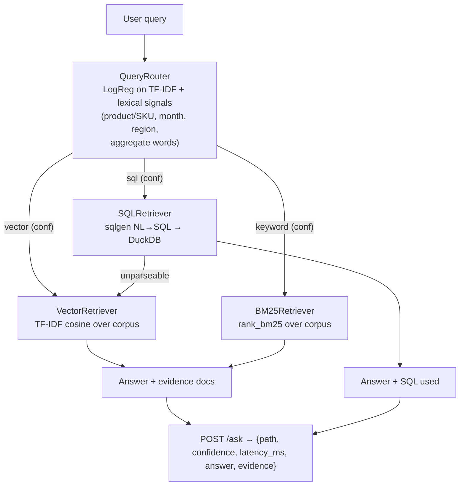

# rag-router — hybrid query routing for RAG systems

A working demo of a production RAG pattern: instead of sending every query
through one retrieval pipeline, a **scikit-learn classifier routes each
natural-language query to the retrieval path best suited to it**, then runs
that path and returns the answer with the chosen path, confidence and latency.

Three retrieval paths:

| Path | Technique | Best for |
|------|-----------|----------|
| `vector` | TF-IDF cosine search over the doc corpus | open-ended conceptual questions ("Can I return opened headphones?") |
| `keyword` | BM25 keyword search | exact product names, SKUs, specs ("SKU KB-2041") |
| `sql` | rule-based NL→SQL over a DuckDB warehouse | aggregates ("total revenue in March") |

## Why routing matters in production RAG

One retrieval strategy is always a compromise. Dense/semantic search is great
for paraphrased questions but misses exact SKUs; BM25 nails exact terms but
fails on "how much money did we make last quarter"; and neither can answer
aggregate questions that need computation over structured data. In production
this shows up as wrong answers, slow dashboards, and users re-phrasing the
same question three times. A lightweight router (milliseconds, no LLM call)
sends each query where it will be answered best — this project demonstrates
the pattern end to end, with an eval harness that measures exactly what you
gain: routing accuracy, per-path retrieval quality, and the latency/quality
trade-off.

## Architecture



`VectorRetriever` uses TF-IDF cosine as an offline, dependency-free stand-in
for dense embedding search — swapping in `sentence-transformers` needs no
router changes. `sqlgen` is a rule-based NL→SQL translator covering seven
aggregate families (revenue/counts per month, units per product, average
order value per region, top product per month, revenue per region per month,
order counts per product per month). Anything outside those families raises
`UnparseableQuery` and the API falls back to vector search instead of
failing.

## Project structure

```
rag-router/
├── README.md
├── requirements.txt
├── rag_router/
│   ├── __init__.py
│   ├── router.py        # QueryRouter: features + LogReg classifier
│   ├── retrieval.py     # VectorRetriever / BM25Retriever / SQLRetriever
│   ├── sqlgen.py        # rule-based NL→SQL (+ UnparseableQuery)
│   └── warehouse.py     # DuckDB views over the CSVs
├── app/
│   └── main.py          # FastAPI app: POST /ask, GET /health, GET /routes
├── scripts/
│   ├── make_data.py     # generates data/ (seeded, deterministic)
│   ├── train_router.py  # trains the router → artifacts/router.joblib
│   └── eval.py          # eval harness → artifacts/eval_results.json
├── data/
│   ├── corpus.jsonl       # 42 docs: 24 product pages, 12 support KB, 6 company
│   ├── products.csv       # 24 products
│   ├── orders.csv         # 500 synthetic orders, Jan–Jun 2026
│   ├── router_train.jsonl # 144 labelled queries
│   └── router_eval.jsonl  # 54 labelled queries + relevance judgements
└── artifacts/
    ├── router.joblib      # trained router (generated)
    └── eval_results.json  # eval metrics (generated)
```

## How to run

```bash
python -m venv .venv && source .venv/bin/activate
pip install -r requirements.txt

python scripts/make_data.py     # generate the synthetic dataset
python scripts/train_router.py  # train the router (prints validation accuracy)
python scripts/eval.py          # run the eval harness
uvicorn app.main:app            # demo API on http://localhost:8000
```

Try it:

```bash
curl -X POST localhost:8000/ask -H 'Content-Type: application/json' \
  -d '{"query": "What was the total revenue in March?"}'
```

## Sample output (real numbers from `scripts/eval.py`)

Router training (stratified 80/20 split of the 144 training queries):

```
validation accuracy: 0.966
              precision    recall  f1-score   support
     keyword      1.000     1.000     1.000         7
         sql      1.000     0.917     0.957        12
      vector      0.909     1.000     0.952        10
```

Eval on the 54 held-out queries (routing + retrieval + latency, router +
retrieval timed together per query; latencies are representative and vary
by machine):

```
Routing accuracy: 50/54 = 0.926

path         n   recall@5   sql-acc  mean lat (ms)
--------------------------------------------------
vector      12      0.958       n/a           3.01
keyword     12      1.000       n/a           1.79
sql         30        nan     1.000          55.38
```

Ablation on the 24 text-retrieval eval queries (mean recall@5 when forcing
every query through one path vs the router's choice): routed **0.979**,
vector-only **0.979**, keyword-only **0.979** — on this small corpus both
lexical methods retrieve well, so the router's measurable win is sending
aggregate questions to SQL, where it scores **30/30 exact answers** (checked
against a pandas oracle over the same CSVs) — a question class neither text
path can answer at all.

The 4 routing misses are genuinely ambiguous queries, e.g.
"What is the price of the VoltEdge 20000mAh Power Bank?" (product name +
number → sql signals, labelled keyword) and
"How many devices did your repair centres fix last year?" ("how many" →
sql signals, labelled vector).

The latency/quality trade-off: keyword/vector answer in ~2–3 ms; the SQL
path costs ~50 ms (NL→SQL parsing + DuckDB execution) but is the only path
that can compute aggregates.

Sample `POST /ask` responses (from a live uvicorn run):

```json
// "What was the total revenue in March?"
{"path": "sql", "confidence": 0.9941, "latency_ms": 40.53,
 "answer": "£51,444.93",
 "sql": "SELECT SUM(order_total) AS value FROM orders WHERE order_month_num = 3"}

// "SKU KB-2041 specifications"
{"path": "keyword", "confidence": 0.9993, "latency_ms": 2.77,
 "answer": "ErgoType Split Keyboard (SKU KB-2041) - Computing. Price: £129.50. ..."}

// routed to sql but outside the supported aggregate families -> graceful fallback
// "What is the battery life of the Aurora X9 Wireless Headphones?"
{"path": "vector", "confidence": 0.0439, "latency_ms": 7.28,
 "answer": "Aurora X9 Wireless Headphones (SKU WH-1002) - Audio. ...",
 "fallback": "routed to 'sql' but the question was outside the supported aggregate families; fell back to 'vector'"}
```

## Limitations (honest)

- The corpus, orders and query labels are synthetic; real-world routing needs
  labelled production queries.
- `sqlgen` covers seven aggregate families with rules, not a learned
  text-to-SQL model — it is intentionally narrow and falls back rather than
  hallucinate SQL.
- The "vector" path is TF-IDF cosine, not true dense embeddings; it stands
  in for them with zero extra dependencies so everything runs offline.

## Requirements

`fastapi`, `uvicorn`, `scikit-learn`, `rank-bm25`, `duckdb`, `numpy`,
`pandas` (see `requirements.txt`). Everything runs offline — no API keys,
no network calls, no secrets.
