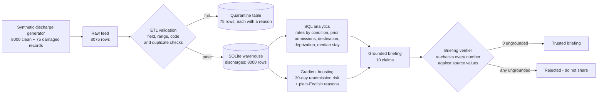

# Readmission Risk Analytics

A production-style health analytics pipeline that follows a hospital discharge from a messy raw feed all the way to a decision a discharge team could act on: who is most likely to be back within 30 days, why, and what the numbers actually say — with every number in the final briefing re-checked against the warehouse before it is trusted.

Built by Jagadeeswara Rao Padala (MSc Artificial Intelligence, Aston University) as a pairing of data analytics and applied AI: a data pipeline and SQL analytics layer underneath, and an explainable machine learning model with a grounded plain-English briefing on top.

## The problem

Unplanned readmissions within 30 days are costly for hospitals and hard on patients, and they are not spread evenly. A small share of discharged patients accounts for a large share of returns, and the signals — repeat admissions, multiple conditions, an emergency arrival, a long stay — are sitting in discharge data that is often too messy to analyse directly. This project tackles the whole chain: clean the feed without hiding its faults, measure readmission patterns honestly, score individual risk with reasons attached, and report the findings in language where no number is invented.

All data is synthetic. No real patient records are used anywhere in this project.

## Architecture



## What it does

1. **Synthetic data generation** (`src/generate.py`) — 8,000 clean discharge records with age band, sex, primary condition (heart failure, COPD, pneumonia, diabetes, hip fracture, stroke, sepsis, AMI), admission type, length of stay, prior admissions in the last year, comorbidity count, discharge destination and deprivation quintile. The readmission outcome is generated with realistic risk logic: prior admissions, comorbidities, emergency admission, longer stays and heart failure or COPD all raise the risk, so there is a genuine signal to find. Exactly 75 deliberately corrupted records (missing values, invalid codes, out-of-range numbers, duplicates) are injected, for a raw feed of 8,075 rows. Fixed seed, fully reproducible.
2. **ETL with quarantine** (`src/etl.py`) — every record is validated for missing values, invalid codes, out-of-range age band, length of stay, prior admissions, comorbidity and deprivation values, invalid readmission flags and duplicate discharge IDs. Failures are never dropped silently: they land in a `quarantine` table with a reason. Clean records load into a `discharges` table in a SQLite warehouse.
3. **SQL analytics** (`src/analytics.py`) — headline measures are computed with SQL queries against the warehouse, not ad-hoc dataframe arithmetic: overall readmission rate, rate by condition, by prior-admissions band, by discharge destination, by deprivation quintile, by admission type, and median length of stay for readmitted versus not readmitted patients.
4. **Risk model** (`src/model.py`) — a scikit-learn `GradientBoostingClassifier` on a stratified train/test split scores 30-day readmission risk. Evaluation reports test ROC-AUC and top-decile capture: the share of all readmissions concentrated in the highest-risk 10% of patients, which is the number a team with limited follow-up capacity actually cares about. Each high-risk patient also gets plain-English reasons, such as "5 prior admissions in the last year".
5. **Grounded briefing** (`src/briefing.py`) — 10 factual claims written only from the analytics and model results. A verifier then extracts every number from every claim and re-checks it against the source values. Any claim with an untraceable number is counted as ungrounded, and the demo refuses to present a briefing with ungrounded claims.

## Sample output

Real output from `python run_demo.py` (seed 42):

```
[1/5] Generated raw discharge feed: 8075 rows
[2/5] ETL complete: 75 quarantined, 8000 loaded into SQLite warehouse
[3/5] SQL analytics: overall 30-day readmission rate 17.0% (1363 of 8000 discharges)
      Riskiest condition: heart failure at 21.1%
[4/5] Model: test ROC-AUC 0.706 | top-decile capture 23.8% of readmissions
[5/5] Grounded briefing: 10 claims, 0 ungrounded
```

Readmission rate by condition:

| Condition | Readmissions / discharges | Rate |
|---|---|---|
| heart failure | 266 / 1260 | 21.1% |
| COPD | 230 / 1182 | 19.5% |
| stroke | 158 / 867 | 18.2% |
| pneumonia | 172 / 1106 | 15.6% |
| hip fracture | 128 / 847 | 15.1% |
| diabetes | 153 / 1022 | 15.0% |
| sepsis | 119 / 795 | 15.0% |
| AMI | 137 / 921 | 14.9% |

Headline findings from the same run:

- Patients with 3 or more prior admissions were readmitted at 31.6%, compared with 9.8% for patients with no prior admissions.
- Emergency admissions were readmitted at 19.3%, compared with 12.1% for elective admissions.
- Patients discharged to a care home had the highest rate by discharge destination, at 19.1%.
- Patients in the most deprived quintile were readmitted at 18.5%, compared with 15.8% in the least deprived quintile.
- Median length of stay was 8.0 days for readmitted patients and 7.0 days for patients who were not readmitted.
- The model's highest-risk test patient (DIS-01428, sepsis, risk 0.816) carried the reasons: 5 prior admissions in the last year, 6 comorbidities, emergency admission, age band 85+.
- The model's most important feature was prior admissions (importance 0.3446), followed by comorbidity count (0.2267) and length of stay (0.1004).

Briefing verification: **10 claims, 0 ungrounded.**

## How to run

```bash
pip install -r requirements.txt
python run_demo.py
python -m pytest tests/ -q
```

The demo regenerates the raw feed (`data/discharges_raw.csv`), rebuilds the warehouse (`data/warehouse.db`) and writes a machine-readable run summary (`data/summary.json`) on every run, so the numbers above reproduce exactly.

## Tests

8 pytest tests cover the whole contract: raw feed size, exact ETL quarantine count (75, each with a reason), warehouse row count (8,000), analytics sanity (condition rates reconcile with the overall count, prior-admissions gradient present), model quality (ROC-AUC above 0.65, top-decile capture above 20%), briefing grounding (0 ungrounded), the verifier catching an invented number, and plain-English risk reasons.

## Tech stack

Python, pandas, scikit-learn, SQLite (standard library), pytest. No external APIs, no API keys, no secrets.

## Limitations

The data is synthetic and the risk logic is built in by design, so the model metrics show the pipeline works end to end — they are not clinical evidence and this is not a clinical tool. On real data the same stages would need proper governance, calibration checks and fairness review across protected groups before any operational use.
