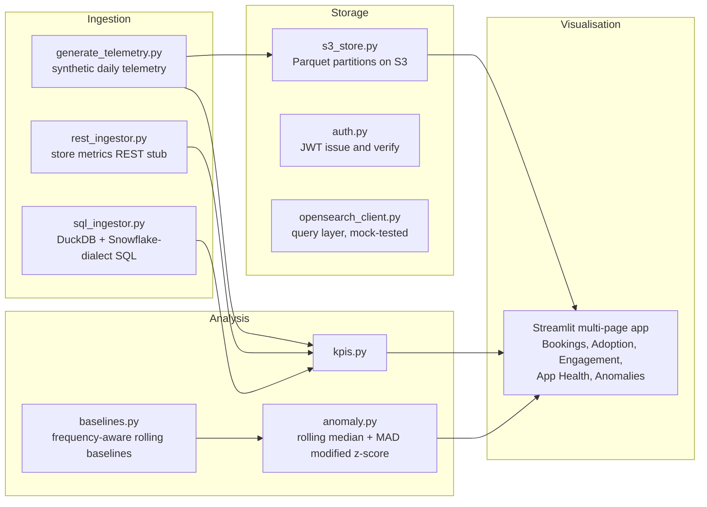

# Travel Telemetry Platform

A Python and Streamlit production intelligence platform for a travel mobile
app. It centralises synthetic telemetry from several sources into leadership
dashboards, organised in a strict four-layer architecture:

Ingestion -> Analysis -> Storage -> Visualisation

**Synthetic data only.** Every number in this project comes from a seeded
synthetic generator (seed 42). It demonstrates the platform design and code.
It is not real app data, not real user data, and not connected to any real
travel or payments system.

## Architecture



## Layer rules

- **Ingestion** lands raw data only. No KPI or anomaly logic.
- **Analysis** is pure functions on DataFrames: no Streamlit imports, no
  session state, no filter knowledge. Callers pass already-filtered frames in,
  which keeps every function unit-testable.
- **Storage** persists and retrieves: Parquet partitions on S3 (boto3),
  JWT auth for API-style access, and the OpenSearch query layer.
- **Visualisation** renders and collects filters only. No business logic in
  the UI layer. Shared filters live in session state, and the active page is
  mirrored into URL query params for navigation.

## What each JD-named source maps to

| Source in the brief | Implementation here |
| --- | --- |
| App telemetry warehouse (Snowflake-style) | DuckDB table locally; KPI queries authored in Snowflake dialect, transpiled and validated with sqlglot, executed on DuckDB |
| Log search (ELF / OpenSearch) | opensearch-py query layer run against a real local OpenSearch 2.19.1 single node: 900 telemetry documents indexed, domain, range and aggregation queries executed. See RESULTS_OPENSEARCH.md |
| App Store Connect style metrics | REST ingestor consuming a local JSON file with the REST response shape |
| Jira / QE style data | QE domain in the generator: defects opened/closed, regression failures |

## Anomaly detection

Rolling median plus MAD-based modified z-score (Iglewicz and Hoaglin),
z = 0.6745 * (x - median) / MAD, threshold configurable (default 3.5), current
point excluded from its own baseline. Baselines are frequency-aware: daily
views use a 7-day window, weekly 28 days, monthly 84 days. Because daily
telemetry has a weekly cycle, daily detection uses the seasonal form of the
same estimator: each point is scored against its own weekday over the prior
12 weeks. A threshold sweep on this dataset set the operating threshold to
5.0 for the pipeline run. The generator injects a known set of anomalies
(3 crash-rate spikes, 2 booking drops) and the test suite scores detection
against that ground truth. The real counts from the actual run are in
RESULTS.md.

## How to run

```bash
python -m venv .venv && .venv/bin/pip install -r requirements.txt
.venv/bin/python -m ingestion.generate_telemetry   # writes data/telemetry_daily.csv
.venv/bin/python run_pipeline.py                    # end-to-end run, writes data/results_summary.json
.venv/bin/python -m pytest tests/ -q                # full test suite
.venv/bin/streamlit run app/app.py                  # dashboards
```

Copy .env.example to .env and set JWT_SECRET before using the auth module.
Secrets come from environment variables only; no secret exists in this repo.

## Honest scope: what ran locally vs authored only

| Capability | Ran locally | Authored only / not run |
| --- | --- | --- |
| Synthetic telemetry generation (180 days) | Yes | |
| DuckDB SQL ingestion and KPI queries | Yes | |
| Snowflake-dialect SQL validated by sqlglot transpilation | Yes | Live Snowflake account: no |
| Anomaly detection scored vs ground truth | Yes, see RESULTS.md | |
| S3 Parquet write and read-back | Yes, against moto (mock S3) through real boto3 | Real AWS S3 bucket: no |
| JWT issue, verify, expiry rejection | Yes | |
| OpenSearch client and query layer | Yes, against a real local OpenSearch 2.19.1 single node (security disabled, loopback only): 900 docs indexed, queries and aggregation executed, see RESULTS_OPENSEARCH.md | Production cluster, replication and security configuration: no |
| Streamlit multi-page app | Yes, headless via AppTest | |
| Dockerfile and docker-compose | | Authored and YAML-checked only. No Docker in this environment, image never built |
| Kubernetes manifests | | Authored and field-validated in tests only. Never applied to a cluster |
| REST ingestor | Yes, against a local JSON stub with the REST response shape | Live external API: no |

## Layout

- `ingestion/` generator, REST stub ingestor, SQL ingestor, Snowflake SQL
- `analysis/` KPIs, baselines, anomaly detection (pure, tested)
- `storage/` S3 Parquet store, JWT auth, OpenSearch query layer
- `app/` Streamlit entry point and one page per domain
- `tests/` pytest suite, including the Streamlit AppTest run
- `k8s/`, `Dockerfile`, `docker-compose.yml` authored platform artefacts
- `docs/adr/` ADR-001 layering, ADR-002 MAD z-score, ADR-003 Parquet on S3
- `RESULTS.md` the real numbers from the actual verification run
